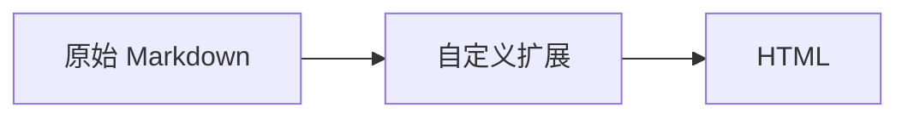

# izone Markdown 扩展语法参考

izone 的文章正文不是标准 Markdown —— 服务端渲染时挂了一组自定义扩展。**本文只收录已经
在本地开发环境实机渲染验证过的语法**，每条都给出「原始写法 → 实际产出 HTML → 坑」。
验证方式见文末。

## 渲染管线

```
Article.body (原始 Markdown)
  → preprocess_mermaid_blocks()       # 把 ```mermaid 换成 <pre class='mermaid'>，并置 has_mermaid
  → markdown.Markdown(extensions=[...]).convert()
  → HTML 存入 Redis（article:markdown:<id>:<update_date>，7 天）
```

代码位置：

| 位置 | 说明 |
|------|------|
| `apps/blog/views.py::make_markdown()` | 文章详情页用的完整扩展集 |
| `apps/blog/views.py::preprocess_mermaid_blocks()` | Mermaid 预处理 |
| `apps/scripts/views.py::make_markdown()` | 脚本分享页，**少一个 `markdown_checklist`**，其余相同 |
| `utils/markdown_ext.py` | 自定义扩展实现（删除线/图标/提示块/代码组） |

扩展集（按注册顺序）：

```python
'markdown.extensions.extra',              # tables / fenced_code / footnotes / attr_list
                                          # def_list / abbr / md_in_html
'markdown_checklist.extension',           # 任务清单（仅文章页有）
CodeHiliteExtension(pygments_formatter=CustomHtmlFormatter),
TocExtension(slugify=slugify),            # 标题锚点
DelExtension(), IconExtension(), AlertExtension(),
CodeItemExtension(), CodeGroupExtension() # utils/markdown_ext.py 自定义
```

## 两条铁律（最容易踩的坑）

**1. 所有围栏（``` 和 :::）必须顶格，行首不能有空格。** 缩进的 Mermaid 围栏会被当成行内代码
渲染成一坨乱码；缩进的 `:::` / `::::` 一律不识别，原样输出成普通段落（缩进 4 格更会被当成
代码块，`::: info` 反被认成代码语言）。

**2. `:::` 开围栏后必须空一行。** 这是草稿里最常出错的地方 —— 提示块的标题解析靠
`block.split()`，开围栏和正文挤在同一个 block 里时，正文第一个词会被误当成标题，或者整个块
直接不渲染成提示块。

```markdown
::: warning 注意        ← 正确：类型后空一格，标题只能是「一个词」

正文，开围栏后空一行。

:::

:::warning 注意         ← 错误：冒号和类型之间少了空格
::: warning 注意        ← 错误：紧跟正文，正文第一段被当成标题
::: danger 多 词 标题   ← 错误：标题含空格，整块退化成普通段落
```

代码组不受第 2 条影响（它包着的是 fenced code，`fenced_code` 预处理器会插入空行），但为了
一致性，建议一律空一行。

## 1. 删除线 `~~text~~`

| 原始写法 | 产出 |
|----------|------|
| `~~这段文字会被划掉~~` | `<del>这段文字会被划掉</del>` |

- 同一行可以出现多处，互不影响。
- 跨软换行有效；跨空行无效。
- 未闭合的 `~~` 原样输出，不会误伤。
- 行内代码与代码块里的 `~~` **不解析**（`` `~~x~~` `` → `<code>~~x~~</code>`），写语法示例时
  放心用反引号包起来。

## 2. 图标 `icon:name`

| 原始写法 | 产出 |
|----------|------|
| `icon:home` | `<i class="fa fa-home"></i>` |
| `icon:exclamation-triangle` | `<i class="fa fa-exclamation-triangle"></i>` |

站点用的是 **FontAwesome 4.7.0**，产出是 `fa fa-<name>` 的 FA4 写法。

**限制（三条都会静默失败，不报错）：**

- 只匹配 `[a-z-]+`：`icon:Home` 大写不匹配 → 原样输出；`icon:long_arrow` 下划线不匹配 →
  渲染出 `fa fa-long` 后面还漏一个 `_arrow`。
- **没有名字校验**：`icon:not-a-real-icon` 照样输出 `<i class="fa fa-not-a-real-icon"></i>`，
  页面上就是个空白，肉眼很容易漏掉。只能用下面清单里的名字。
- 页面加载 FA 4.7 的 CSS，FA5/6 的图标名（`fa-solid`、`fa-magnifying-glass` 等）无效。

常用且已确认存在于 FA 4.7 的名字：

```
home  search  tag  tags  bookmark  book  folder-open  file-code-o
code  terminal  bug  wrench  cog  cogs  sitemap  exchange
server  database  hdd-o  cloud  dashboard  plug  bolt  shield  lock  key
check  check-circle-o  times  times-circle  ban  question-circle  exclamation-triangle
info-circle  lightbulb-o  rocket  flask  magic  star  flag  list-alt
github  git  linux  windows  users  user  briefcase  graduation-cap  certificate
clock-o  calendar  bell  comment  comments  thumbs-up  eye  filter  sort
arrow-right  chevron-right  play  refresh  download  upload  link  plus  minus  pencil-square-o  trash-o
```

在标题、表格单元格、列表项里都能用。标题里用图标时，锚点 id 会忽略图标文字
（`## 1. 图标 icon:home 测试` → `id="1-图标-测试"`）。

## 3. 提示块 `:::`

仿 VitePress 的提示块，产出 Bootstrap alert。

```markdown
::: warning 注意

正文可以有多段，也可以放列表。

- 列表项一
- 列表项二

:::
```

产出：

```html
<div class="alert alert-warning" role="alert">
<p><strong><i class="fa fa-warning mr-1"></i><span>注意</span></strong></p>
<p>正文可以有多段，也可以放列表。</p>
<ul><li>列表项一</li><li>列表项二</li></ul>
</div>
```

| 类型 | 可用 | 标题行图标 |
|------|------|------------|
| `primary` | ✅ | `fa-info-circle` |
| `secondary` | ✅ | `fa-info-circle` |
| `success` | ✅ | `fa-info-circle` |
| `info` | ✅ | `fa-info-circle` |
| `warning` | ✅ | `fa-warning` |
| `danger` | ✅ | `fa-warning` |

`alert-light`、`alert-dark` 等不在支持列表里，写了不会渲染成提示块。

**约束：**

- 类型与 `:::` 之间**必须有空格**（`::: info` ✅ / `:::info` ❌）。
- 标题**只能是单个词**，`:::` 后第三个 token 就是标题。`::: danger 多 词 标题` 因为 4 个
  token 直接判定失败，整块退化成三个普通段落。写多词标题不如把标题省掉，把话放进正文。
- 不带标题时只写 `::: info`，标题行整个不生成。
- 结束围栏 `:::` 必须在块的末尾：后面要么是空行，要么是文末。`:::` 后紧跟正文段落会整块失败。
- 块内可以嵌套删除线、图标、列表、多段落。

## 4. 代码组（多语言 Tab）

````markdown
:::: code-group

::: code-item Python

```python
def greet(name):
    return f"hello {name}"
```

:::

::: code-item Bash

```bash
echo "hello"
```

:::

::::

````

产出：`<div class="tab-content code-group" id="nav-<12位随机>">`，内部每个 `code-item` 是一个
`<div class="tab-pane fade" data-code-name="Python" id="nav-<随机>" role="tabpanel">`。前端
`blog/static/blog/js/code.js` 收集这些 `tab-pane`，在代码组**前面**插入一个 Bootstrap nav-tabs，
`data-code-name` 就是 Tab 文案，第一个 pane 自动 `show active`。每个 pane 内的代码块照常带
Copy 按钮和语言标签。

**约束：**

- 外层是 **4 个冒号** `:::: code-group`，内层是 **3 个冒号** `::: code-item`。
- `code-item` 的标签名**只能是单个词**（同样走 `split()` 三 token 判断）。`::: code-item React 组件`
  会失败 —— 代码块会直接摊在代码组容器里，Tab 导航是空的。
- 一个代码组内 `code-item` 数量不限，页面上同一篇文章可以放多个代码组（id 各自随机，不冲突）。
- 标签名建议用 `Python` / `Bash` / `Go` / `nginx.conf` 这类单个 token。

## 5. 表格 / 任务清单 / 脚注 / 定义列表 / 属性列表 / 缩写

来自 `markdown.extensions.extra` 与 `markdown_checklist`，都是标准语法。

**表格**：

```markdown
| 语法 | 说明 |
|------|------|
| `~~x~~` | 删除线 |
```

单元格内可以正常用删除线、图标（裸 `~~删除~~` 也生效，不必包反引号）。

**任务清单**（仅文章页，脚本页没有）：

```markdown
- [x] 已完成的条目
- [ ] 未完成的条目
```

产出 `<ul class="checklist">` + `<input type="checkbox" disabled ...>`。**只有勾选态是只读的**，
页面上点不动，纯粹是视觉标记。

**脚注**：

```markdown
正文可以带脚注[^demo]。

[^demo]: 这是脚注的内容。
```

产出 `<sup class="footnote-ref">` + 文末 `<div class="footnote">`，带 `↩` 回跳链接。

**定义列表**：

```markdown
Markdown
: 一种轻量级标记语言
```

**属性列表**（给块级元素加 class）：

```markdown
这是一个居中段落。
{: .text-center }
```

**缩写**：

```markdown
HTML 是超文本标记语言。

*[HTML]: HyperText Markup Language
```

产出 `<abbr title="HyperText Markup Language">HTML</abbr>`（鼠标悬停显示全称）。

## 6. 原始 HTML 与容器块

原始 HTML 直接透传（不做转义），可以拿来加 Bootstrap 容器：

```markdown
<div class="alert alert-light border" markdown="1">

**加粗** 与 `行内代码` 在 `markdown="1"` 的容器里照常解析。

</div>
```

`markdown="1"`（`md_in_html` 扩展）是必须的 —— 没有它，容器内的 Markdown 会原样输出成
`**加粗**` 字样。**只在内置扩展表达不了时才用原始 HTML**，能用 `:::` 就用 `:::`。

## 7. Mermaid 图

````markdown

````

`preprocess_mermaid_blocks` 把它换成 `<pre class='mermaid'>`，页面检测到 `has_mermaid` 后加载
mermaid 11.4.1 并 `startOnLoad: true` 渲染。

**约束：**

- 围栏**必须顶格**（行首 0 空格）。缩进两格就会预处理失败，退化成一段行内代码
  （`<p><code>mermaid\n graph TD…</code></p>`），而不是图。
- 开围栏行不能带额外内容：` ```mermaid graph TD ` ❌，类型写在下一行。
- 关闭围栏 `` ``` `` 独占一行。
- 块内可以有空行、可以放多个 Mermaid 块。
- 空的 mermaid 块不会置 `has_mermaid`，会退化成 `language-mermaid` 的高亮代码块。

排版上遵守 SKILL.md 的既有约定：5-10 个节点以内，别做深层嵌套 subgraph。

## 何时该用这些扩展

默认还是标准 Markdown（标题、段落、列表、表格、代码块）。下面几种情况才值得动用扩展：

| 场景 | 用什么 |
|------|--------|
| 同一段逻辑的多种语言实现 | 代码组 `:::: code-group` |
| 踩坑警告、前置条件、版本要求 | 提示块 `::: warning` / `::: danger` |
| 补充说明、旁支信息 | 提示块 `::: info` / `::: primary` |
| 强调方案变更（旧做法 → 新做法） | 删除线 `~~旧方案~~` |
| 行内强调关键概念、状态 | 图标 `icon:`（克制使用，一段最多一两个） |
| 部署流程、架构、时序 | Mermaid |
| 检查清单、迁移进度 | 任务清单 |
| 引用来源、补充注释 | 脚注 |

**反面用法**：不要为了用扩展而用。整篇文章塞满提示块和图标，读起来比纯文本更费劲。
提示块一段最多一两个，图标别当项目符号使。

## 验证方法（本地）

改完正文后用本地 API 推送成草稿，再走真实视图取渲染结果，比肉眼看页面靠谱。
本地解释器路径、Redis/MySQL 端口见本地记忆，不在本文件里写死。

```bash
# 1. 取本地 token —— 生产 token 不在本地库里，直接复用会 401
#    用站点所有者账号的 Token.objects.get(...).key，只取不打印到日志

# 2. 以草稿发布（is_publish=False，不污染公开内容），slug 相同即为更新
#    POST $IZONE_API_BASE/skill/articles/publish/

# 3. 草稿详情页对外 404，用 Django test client 以作者身份渲染真实页面：
#    c.force_login(作者); c.get('/article/<slug>/')
#    再从响应 HTML 里正则断言各扩展产物（<del> / alert / tab-pane / <pre class='mermaid'> 等）
```

第 3 步是关键：草稿页匿名访问是 404，必须 `force_login` 才能拿到渲染后的 HTML。
断言时注意正文里合法的行内代码（如表格里演示语法的 `` `::: info` ``）也会出现 `:::`，
别把「未解析围栏」和「示例文本」搞混 —— 判据应是 `<p>:::` 这种被当成段落的围栏。

快速试语法时不必走发布流程，直接调同一套扩展集即可（脚本放仓库外的临时目录，
运行时要带 `PYTHONPATH=<repo root>`，否则 `import izone` 失败）：

```python
from blog.views import make_markdown, preprocess_mermaid_blocks
content, has_mermaid = preprocess_mermaid_blocks(src)
print(make_markdown().convert(content))
```

本地 `DEBUG=True` 时文章 markdown 缓存**不参与读取**，每次都会重渲染，所以改完正文刷新页面就能
看到新结果，不用手动清缓存。
